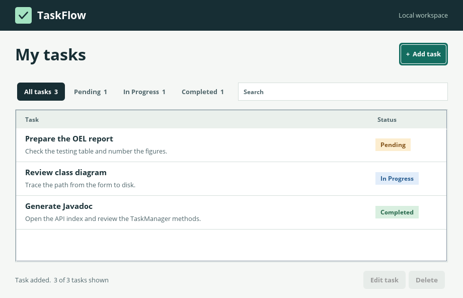

# TaskFlow

**Java-Based Task Management System Using Modern Software Construction Tools**

TaskFlow is a Java 17 desktop task management application developed for the Software Construction Open-Ended Lab (OEL) at the Military College of Signals (MCS), National University of Sciences & Technology (NUST).

The application provides a simple and organized workspace for creating, viewing, updating, deleting, searching and tracking tasks.

**Course:** Software Construction  
**University:** NUST — Military College of Signals  
**Batch and Section:** BESE-30 C

**Project Members:**
- Haifa Khan Afridi
- Emman Khattak

## Features

TaskFlow includes the following functionality:

- **Add Tasks:** Create tasks with a required title and optional description.
- **View Tasks:** Display tasks in an organized desktop interface.
- **Edit Tasks:** Update task titles, descriptions and statuses.
- **Delete Tasks:** Remove tasks using a confirmation dialog.
- **Status Management:** Track tasks as Pending, In Progress or Completed.
- **Search:** Search tasks by title or description.
- **Status Filtering:** Filter tasks according to their progress.
- **Input Validation:** Prevent empty titles and handle invalid operations.
- **Local Storage:** Preserve saved tasks between application sessions.
- **Task Counters:** Display the total number of tasks in each status.
- **Error Handling:** Show understandable messages when operations cannot be completed.

The application uses Java Swing for the graphical interface and standard Java libraries for task management and local persistence.

## Technologies Used

| Technology | Purpose |
|---|---|
| Java 17 | Core application development |
| Java Swing | Desktop graphical user interface |
| Java Collections | In-memory task management |
| File I/O | Local persistence |
| Eclipse / VS Code | Development and debugging |
| Git | Version control |
| GitHub | Repository hosting and collaboration |
| Javadoc | API documentation |

## Getting Started

### Prerequisites

Install the following:

- Java Development Kit (JDK) 17 or newer.
- Eclipse IDE for Java Developers or Visual Studio Code.
- Git, if you want to clone the repository or contribute.

Verify Java installation:

`java -version`

`javac -version`

`javadoc --version`

A complete JDK is required to compile the source code and generate documentation.

### Clone the Repository

Open PowerShell or a terminal and run:

`git clone https://github.com/haifaafridi/TaskFlow_OEL.git`

Move into the project folder:

`cd TaskFlow_OEL`

The cloned folder contains the Java source code, test suites, documentation and application launch scripts.

## Run TaskFlow on Windows

Open PowerShell or the VS Code terminal inside the project folder.

Run:

`.\taskflow.cmd run`

The TaskFlow desktop application should open.

To run the model and storage tests:

`.\taskflow.cmd test`

To run desktop interface tests:

`.\taskflow.cmd ui-test evidence`

To regenerate Javadoc documentation:

`.\taskflow.cmd docs`

The generated documentation can be opened at:

`docs/api/index.html`

The scripts compile the Java source before executing their respective actions.

## Run TaskFlow on macOS or Linux

Open a terminal inside the cloned project directory.

Launch TaskFlow:

`bash taskflow.sh run`

Run model and storage tests:

`bash taskflow.sh test`

Run desktop tests:

`bash taskflow.sh ui-test evidence`

Generate documentation:

`bash taskflow.sh docs`

The desktop application and its UI tests require a graphical environment.

## Run TaskFlow in Eclipse

1. Open Eclipse IDE.
2. Go to **Window → Preferences → Java → Installed JREs**.
3. Add and select your JDK 17 installation.
4. Under **Execution Environments**, associate `JavaSE-17` with that JDK.
5. Select **File → Import → General → Existing Projects into Workspace**.
6. Browse to the cloned TaskFlow repository folder.
7. Select the TaskFlow project and click **Finish**.
8. Expand `src → taskflow` in Package Explorer.
9. Right-click `TaskFlow.java`.
10. Select **Run As → Java Application**.

To debug, set a breakpoint in `TaskFlow.java`, start the debugger and resume execution using F8.

## How to Use TaskFlow

### Add a Task

1. Click **+ Add task**.
2. Enter a task title.
3. Optionally enter a description.
4. Choose a task status.
5. Click **Add task** to save.

New tasks default to Pending.

### Edit a Task

1. Select an existing task.
2. Click **Edit task**, or double-click the row.
3. Modify its title, description or status.
4. Click **Save changes**.

### Delete a Task

1. Select a task.
2. Click **Delete**.
3. Review the confirmation dialog.
4. Choose **Delete task** to confirm or **Cancel** to retain it.

### Search and Filter Tasks

Use the Search field to locate tasks by title or description.

Use the status filters to display:

- All tasks
- Pending
- In Progress
- Completed

The interface shows the task count for each status and the number of visible matching tasks.

## Project Structure

| Directory or File | Description |
|---|---|
| `src/taskflow/` | Java application source files |
| `test/taskflow/` | Automated test suites |
| `docs/` | Documentation and testing records |
| `docs/api/index.html` | Generated Javadoc documentation |
| `docs/TESTING.md` | Test scenarios, expected results and observations |
| `docs/verification.txt` | Compilation and verification records |
| `taskflow.cmd` | Windows build and execution script |
| `taskflow.sh` | macOS/Linux execution script |
| `README.md` | Project setup and usage instructions |

### Important Java Components

**TaskFlow:** Main application entry point.

**Task:** Represents an individual task with an identifier, title, description and status.

**Status:** Defines the accepted task statuses.

**TaskManager:** Manages task creation, editing, deletion and retrieval.

**TaskStore:** Handles local storage and loading of tasks.

**TaskBoard:** Controls the main application interface, task filters and user actions.

**TaskDialog:** Provides the forms and dialogs for task operations.

**TaskTable:** Displays task records in the interface.

**Theme:** Maintains consistent interface styling.

## Data Structures and Storage

TaskFlow uses an `ArrayList` to maintain tasks in their creation order.

Each task has a unique UUID, allowing tasks with identical titles to be managed independently.

The application stores tasks locally using a properties file:

`.taskflow/tasks.properties`

This file is located in the current user's home directory under normal execution.

TaskFlow uses file locking and temporary-file replacement to reduce the risk of conflicting writes and incomplete saves.

To run the application against a separate demonstration workspace after compilation, use:

`java -Dtaskflow.dir=demo-workspace -cp out taskflow.TaskFlow`

## Testing

TaskFlow includes two automated testing suites.

### Model and Storage Tests

The model and storage tests check:

- Updating or deleting nonexistent tasks.
- Handling duplicate task titles.
- Rejecting invalid titles and statuses.
- Preventing conflicting workspace access.
- Preserving task data across restarts.
- Handling storage failures and invalid files.

The project includes 10 model and storage checks.

### Desktop Interface Tests

The desktop tests cover:

- Displaying an empty task list.
- Adding and viewing tasks.
- Rejecting empty titles.
- Editing existing tasks.
- Changing and filtering task statuses.
- Searching tasks.
- Cancelling and confirming deletion.
- Preserving saved tasks across restarts.
- Resizing the application.

The project includes 12 desktop checks.

Run both suites to verify the application:

`.\taskflow.cmd test`

`.\taskflow.cmd ui-test evidence`

The original project verification recorded 22 passing checks. Contributors should rerun the relevant checks after making changes.

## Javadoc Documentation

Javadoc is used to generate HTML documentation from Java source comments.

To generate the documentation on Windows:

`.\taskflow.cmd docs`

Open:

`docs/api/index.html`

The documentation includes class information, method descriptions, parameters, return values and documented exceptions.

## Contributing

Contributions are welcome from project collaborators.

To maintain a stable project, changes should be developed on a separate branch and reviewed through a pull request.

### Contribution Workflow

**1. Clone the repository**

`git clone https://github.com/haifaafridi/TaskFlow_OEL.git`

**2. Enter the project directory**

`cd TaskFlow_OEL`

**3. Create a new branch**

`git switch -c docs/improve-readme`

**4. Make your changes**

Edit the relevant source or documentation files and verify that the changes are correct.

**5. Review your changes**

`git status`

`git diff`

**6. Stage the modified files**

For a README-only change:

`git add README.md`

**7. Create a meaningful commit**

`git commit -m "docs: improve project documentation"`

**8. Push your branch**

`git push -u origin docs/improve-readme`

**9. Open a pull request**

On GitHub, select **Compare & pull request**, provide a brief explanation of the changes and submit the pull request to the `main` branch.

The repository maintainer can review and merge the contribution.

### Contribution Guidelines

- Keep changes relevant to TaskFlow.
- Use clear and meaningful commit messages.
- Preserve Java 17 compatibility.
- Avoid introducing unnecessary dependencies.
- Follow the existing code structure and naming conventions.
- Test changes before submitting them.
- Update documentation when functionality changes.
- Use your own Git identity for commits.
- Do not commit temporary build files or personal workspace data.

## Troubleshooting

### Git reports "not a git repository"

This usually means the terminal is not inside the cloned repository.

Move into the correct directory:

`cd TaskFlow_OEL`

Check the repository:

`git status`

If the repository was downloaded as a ZIP rather than cloned, its Git metadata may be missing. Clone the published repository to work with its commit history.

### Java is not recognized

Install a complete JDK and ensure Java is available in your system PATH.

Verify using:

`java -version`

`javac -version`

If these commands are not recognized, check the JDK installation and environment variables.

### TaskFlow does not launch

Make sure your terminal is inside the directory containing `taskflow.cmd`.

Run:

`.\taskflow.cmd run`

Check that your JDK is installed and that no conflicting TaskFlow instance is holding the same workspace lock.

### Tasks are not appearing

Check the selected status filter and search query.

Switch to **All tasks** and clear the search field to display the complete list.

### Javadoc is not opening

Regenerate the documentation:

`.\taskflow.cmd docs`

Then open:

`docs/api/index.html`

### Tests are failing

Run each suite separately:

`.\taskflow.cmd test`

`.\taskflow.cmd ui-test evidence`

Review any displayed failure messages. The desktop test suite requires a graphical environment.

## Version Control

TaskFlow uses Git to track project changes.

Useful commands include:

| Command | Purpose |
|---|---|
| `git status` | Check the working directory |
| `git log --oneline` | View commit history |
| `git diff` | Review uncommitted changes |
| `git add` | Stage selected changes |
| `git commit` | Save a new revision |
| `git pull` | Retrieve and integrate remote changes |
| `git push` | Publish local commits |

GitHub hosts the published project, making its development history and future contributions accessible to collaborators.

## Project Information

**Project:** TaskFlow — Task Management System  
**Course:** Software Construction  
**Institution:** National University of Sciences & Technology, Military College of Signals  
**Section:** BESE-30 C  
**Language:** Java  
**Interface:** Java Swing  
**Repository:** https://github.com/haifaafridi/TaskFlow_OEL

TaskFlow demonstrates fundamental software construction practices through object-oriented programming, desktop interface design, input validation, local persistence, automated testing, version control and generated code documentation.